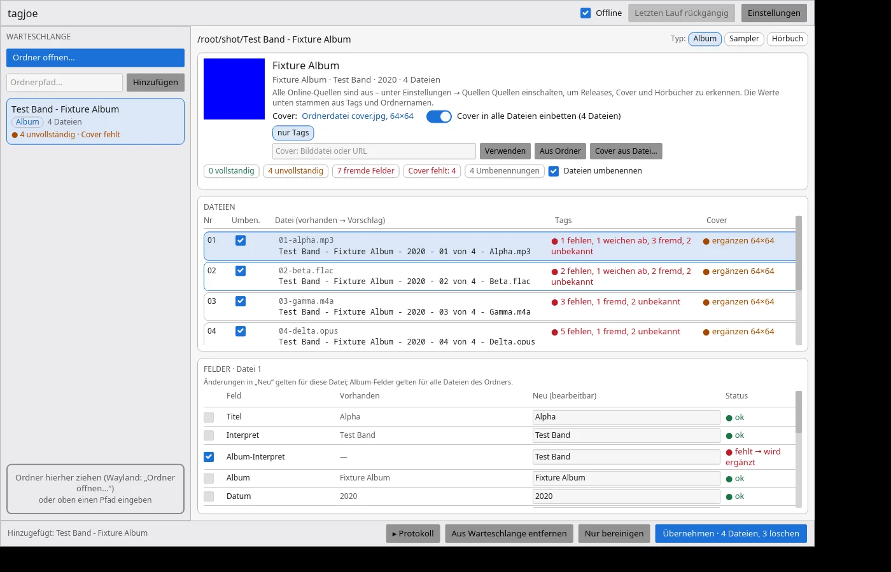
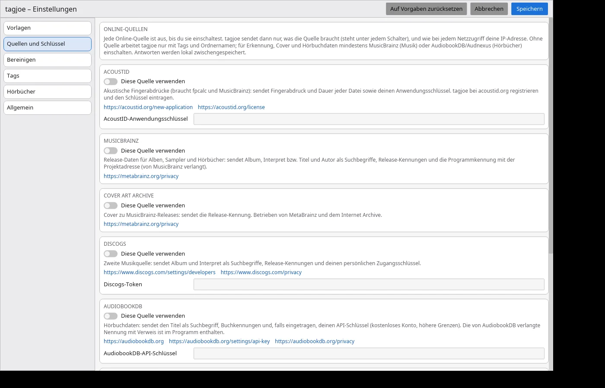

<p align="center">
  
</p>

# tagjoe

[English](README.md) · **Deutsch**

> **Tags, Cover und Dateinamen für Alben, Sampler und Hörbücher – Feld für Feld geprüft,
> vorgeschlagen, mit einem Klick übernommen und mit einem weiteren rückgängig gemacht.**
> Ordner auf das Fenster ziehen. tagjoe liest jede Datei, erkennt das Release (Audio-Fingerabdruck
> über AcoustID, MusicBrainz, Cover Art Archive, Discogs; AudiobookDB, Audnexus und die Deutsche
> Nationalbibliothek für Hörbücher), prüft **jedes Tag-Feld** gegen ein festes Schema und schlägt
> Tags, eingebettetes Cover und Dateinamen vor. Geschrieben wird erst nach **Übernehmen**; jeder
> Lauf schreibt ein Journal für **Rückgängig**.
>
> **Keine Telemetrie, nichts von allein an:** tagjoe sendet keine Nutzungsdaten. Jede
> Online-Quelle ist aus, bis du sie einschaltest – was jede bekommt:
> [Datenschutz](docs/DATENSCHUTZ.md).

<p align="center">
  <a href="https://www.johnlose.de/unterstutzung-fur-john-joe-lose/"></a>
</p>
<p align="center">
  <a href="docs/install-ubuntu.md"></a>
  &nbsp;
  <a href="docs/install-debian.md"></a>
</p>

- **Ein Schema, jedes Feld:** Album-Interpret, Album, Jahr, Titelnummer und Gesamtzahl, Titel,
  Genre, Label, Katalognummer, Barcode, MusicBrainz-Kennungen – bei Hörbüchern Autor, Buch,
  Sprecher, Serie, Kapitel. Jedes Feld ist **ok**, **fehlt**, **weicht ab** oder **fremd**.
- **Fremde Felder fliegen raus:** Kommentare, Encoder-Reste, Shop-URLs, Bewertungen anderer
  Programme werden aufgelistet und entfernt (eine Behalte-Liste schützt Gewünschtes, z. B.
  `REPLAYGAIN_*`); ID3v1- und APE-Container in MP3-Dateien fallen weg.
- **Cover:** aus den Quellen, dem Ordner, einer Datei oder einer Adresse; das beste wird in jede
  Datei eingebettet, das Ordnerbild danach auf Wunsch entfernt.
- **Namen aus Vorlagen:** `{albumartist} - {album} - {year} - {track} von {tracktotal} - {title}`
  und eigene, mit Funktionen und Bedingungen, Live-Vorschau, wahlweise Ordnernamen für Jellyfin
  und Plex.
- **Manuell vervollständigen:** jedes Feld bearbeiten, Kandidaten wählen, eintippen, was keine
  Quelle weiß.
- **Ordnerbereinigung:** NFO-, M3U-, Bild-, TXT- und andere Reste werden nach fehlerfreiem Lauf
  gelöscht – jede Datei vorher sichtbar und abwählbar.
- **Fortschritt und Protokoll:** jede geschriebene, umbenannte oder gelöschte Datei im Fenster und
  in `log.txt`.

## Dokumentation

- [`docs/install-ubuntu.md`](docs/install-ubuntu.md) · [`docs/install-debian.md`](docs/install-debian.md) – installieren, aktualisieren, selbst bauen
- [`docs/DATENSCHUTZ.md`](docs/DATENSCHUTZ.md) – Datenschutz: jeder Netzzugriff, was wo gespeichert wird
- [`THIRD_PARTY.md`](THIRD_PARTY.md) – Bibliotheken Dritter, externe Programme und Datenquellen mit Lizenzen

> [!WARNING]
> **Privates Hobbyprojekt – unmaintained.**
> Dieses Repository dient meinem eigenen Gebrauch und ist nur der Einfachheit halber öffentlich.
>
> * **Kein Support versprochen:** Pull Requests werden nicht bearbeitet, Funktionswünsche nicht zugesagt. Fehler und Wünsche können gemeldet werden (siehe [Fehler und Wünsche melden](#fehler-und-wünsche-melden)) – es kann dauern, bis sie angesehen werden.
> * **Keine Gewähr, Haftung:** Das Programm wird kostenlos als privates Projekt „wie es ist“ bereitgestellt. Es besteht kein Anspruch auf Verfügbarkeit, Fehlerfreiheit, Updates oder Unterstützung. Für Schäden aus der Nutzung hafte ich nur bei Vorsatz, grober Fahrlässigkeit und bei Verletzung von Leben, Körper oder Gesundheit; im Übrigen nur nach den gesetzlichen Vorschriften.
> * **Es schreibt deine Dateien:** tagjoe ändert Tags, benennt Dateien und Ordner um und löscht Restdateien – nur nach **Übernehmen**, mit Journal für **Rückgängig** (gelöschte Ordnerdateien kommen nicht zurück). Erst an einer Kopie ausprobieren.
> * **Eigene Umgebung:** Entwickelt und getestet nur auf meinen eigenen Rechnern (Ubuntu 24.04/26.04, Bau-Container Debian 12, Musik und Hörbücher auf SMB-Freigaben). Anderswo kann es scheitern.
> * **Netz:** Nichts wird angefragt, bis du eine Quelle einschaltest. Jeder Zugriff steht in [`docs/DATENSCHUTZ.md`](docs/DATENSCHUTZ.md). **Lies den Code, bevor du ihn installierst.**
> * **Keine Updates garantiert:** Änderungen, Brüche oder das Löschen des Repositorys sind jederzeit ohne Ankündigung möglich.

<p align="center">
  
  <br>
  <em>Hauptfenster: Warteschlange, Release, Dateien und Felder</em>
  <br><br>
  
  <br>
  <em>Einstellungen → Quellen: jede Quelle aus, bis sie eingeschaltet wird</em>
</p>

---

## Plattformen

| Plattform | Stand | Hinweis |
| :--- | :--- | :--- |
| **Linux (Ubuntu 24.04 / 26.04, Debian 12 / 13)** | Entwicklung | ein `.deb` für alle, Installation per Skript ([Ubuntu](docs/install-ubuntu.md), [Debian](docs/install-debian.md)) |
| **Windows 10/11** | geplant | MSI |
| **macOS** | später | |

## Installation

- **Ubuntu / Debian:**

  ```bash
  curl -fsSL https://raw.githubusercontent.com/joeMJ/tagjoe/main/install.sh | bash
  ```

  Erst lesen, dann ausführen (empfohlen, wenn du Skripte aus dem Internet nicht ungesehen
  starten willst):

  ```bash
  curl -fsSL -o install-tagjoe.sh https://raw.githubusercontent.com/joeMJ/tagjoe/main/install.sh
  less install-tagjoe.sh
  bash install-tagjoe.sh
  ```

- **Von Hand:** Paket und `SHA256SUMS` von der [Release-Seite](https://github.com/joeMJ/tagjoe/releases/latest), siehe [docs/install-ubuntu.md](docs/install-ubuntu.md).

## So arbeitet es

1. **Ordner öffnen** (Knopf, Pfad oder Ziehen) – ein Album, ein Sampler oder ein Hörbuch;
   CD-Unterordner werden zusammengefasst. tagjoe liest jede Datei (MP3 mit ID3v2/ID3v1/APE, FLAC,
   Ogg Vorbis, Opus, MP4/M4A/M4B, AAC, WAV, AIFF, APE, WavPack, Musepack).
2. **Erkennen:** Fingerabdrücke (`fpcalc`) gehen an AcoustID, Releases kommen von MusicBrainz und
   Discogs; Hörbücher von AudiobookDB, Audnexus (nie Audible direkt) und der Deutschen
   Nationalbibliothek. Kandidaten werden nach Fingerabdruck-Treffern, Laufzeiten und Titeln
   bewertet.
3. **Prüfen:** jedes Feld jeder Datei gegen das Schema; fremde Einträge werden aufgelistet.
4. **Entscheiden:** Kandidat oder „nur Tags“ wählen, Felder bearbeiten, Cover wählen, einzelne
   Änderungen, Umbenennungen oder Löschungen abwählen.
5. **Übernehmen:** Tags, Cover und Namen werden geschrieben, Restdateien gelöscht, das Journal
   gesichert. **Letzten Lauf rückgängig** stellt Namen, Tags und Cover wieder her.

Die Kommandozeile kann dasselbe: `tagjoe scan | propose | identify | apply | clean | undo | update-check`.

## Datenschutz

tagjoe sendet keine Nutzungsdaten und hat keine Telemetrie. Jede Online-Quelle ist standardmäßig
aus; jeder Netzzugriff und was wo gespeichert wird: [`docs/DATENSCHUTZ.md`](docs/DATENSCHUTZ.md).

## Datenquellen

- **[MusicBrainz](https://musicbrainz.org)** und **[Cover Art Archive](https://coverartarchive.org):** Release-Daten und Cover; Kerndaten unter [CC0](https://musicbrainz.org/doc/About/Data_License).
- **[AcoustID](https://acoustid.org):** akustische Fingerabdrücke, braucht einen kostenlosen Anwendungsschlüssel; die Fingerabdrücke berechnet [Chromaprint](https://acoustid.org/chromaprint) (`fpcalc`) lokal.
- **[Discogs](https://www.discogs.com):** zweite Musikquelle mit persönlichem Zugangsschlüssel.
- **[AudiobookDB](https://audiobookdb.org)** und **[Audnexus](https://github.com/laxamentumtech/audnexus):** Hörbuchdaten; AudiobookDB bittet um diese Nennung.
- **[Deutsche Nationalbibliothek](https://www.dnb.de):** deutsche Hörbücher über SRU; Cover per ISBN von [Open Library](https://openlibrary.org).

Musik, Hörbücher und Cover stammen aus deinen eigenen Dateien und den Quellen oben; tagjoe liefert nichts davon mit.

## Fehler und Wünsche melden

Über die [Issues auf GitHub](https://github.com/joeMJ/tagjoe/issues) (GitHub-Konto nötig). Es
kann dauern, bis ein Issue angesehen wird.

Hilfreich sind:

- Version (**Einstellungen → Allgemein**) und System (z. B. Ubuntu 26.04, Debian 13)
- die Art des Ordners (Album, Sampler, Hörbuch), das Dateiformat und was genau passiert
- Schritte, die den Fehler auslösen, und der genaue Wortlaut einer Meldung aus dem Protokoll

**Nie mitschicken:** deine Schlüssel für AcoustID, Discogs oder AudiobookDB, deine
Konfigurationsdatei oder private Pfade. Namen in Bildschirmfotos nach Wunsch unkenntlich machen.

## Lizenz

Apache-2.0, siehe [LICENSE](LICENSE). Bibliotheken Dritter, externe Programme und Datenquellen mit
ihren Lizenzen: [THIRD_PARTY.md](THIRD_PARTY.md).
