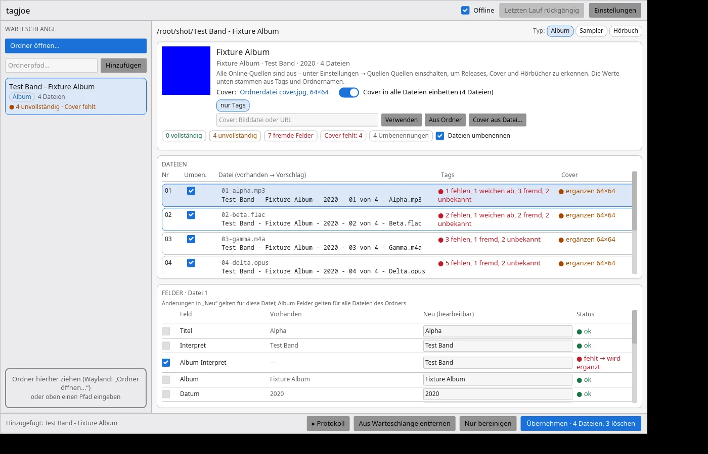
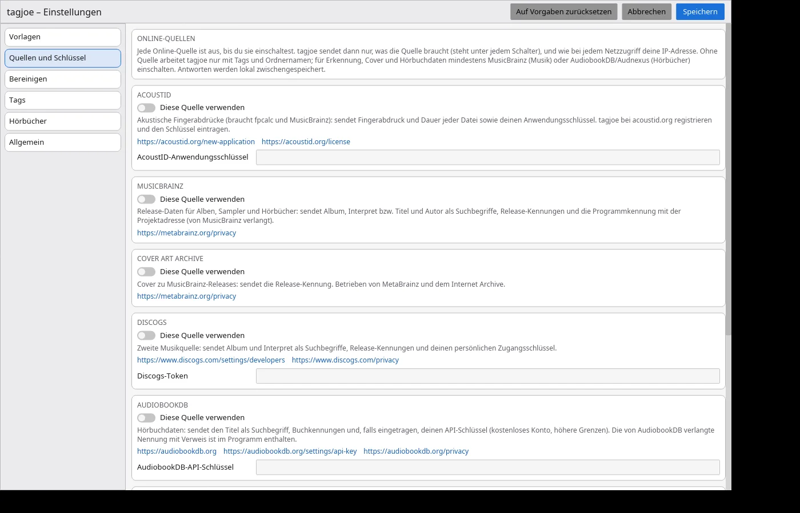

<p align="center">
  
</p>

# tagjoe

**English** · [Deutsch](README.de.md)

> **Tags, covers and file names for albums, compilations and audiobooks – checked field by
> field, proposed, applied with one click, undone with one more.**
> Drop a folder onto the window. tagjoe reads every file, identifies the release (acoustic
> fingerprints via AcoustID, MusicBrainz, Cover Art Archive, Discogs; AudiobookDB, Audnexus and
> the Deutsche Nationalbibliothek for audiobooks), checks **every tag field** against a fixed
> schema and proposes tags, an embedded cover and file names. Nothing is written until you click
> **Apply**; every run keeps a journal for **Undo**.
>
> **No telemetry, nothing on by default:** tagjoe sends no usage data. Every online source is off
> until you switch it on – what each one receives: [Privacy](docs/DATENSCHUTZ.en.md).

<p align="center">
  <a href="https://www.johnlose.de/unterstutzung-fur-john-joe-lose/"></a>
</p>
<p align="center">
  <a href="docs/install-ubuntu.en.md"></a>
  &nbsp;
  <a href="docs/install-debian.en.md"></a>
</p>

- **One schema, every field:** album artist, album, year, track and total, title, genre, label,
  catalogue number, barcode, MusicBrainz ids – and for audiobooks author, book, narrator, series,
  chapter. Each field is **ok**, **missing**, **differs** or **foreign**.
- **Foreign fields go:** comments, encoder junk, shop URLs, ratings from other programs are listed
  and removed (a keep list protects what you want, e.g. `REPLAYGAIN_*`); ID3v1 and APE containers
  in MP3 files are dropped.
- **Covers:** from the sources, the folder, a file or a URL; the best one is embedded into every
  file, the folder image is removed afterwards if you like.
- **Names from templates:** `{albumartist} - {album} - {year} - {track} von {tracktotal} - {title}`
  and your own, with functions and conditions, live preview, optional folder names for Jellyfin
  and Plex.
- **Manual completion:** edit any field, pick a candidate, type what no source knows.
- **Folder clean-up:** NFO, M3U, image, TXT and other leftovers are deleted after a clean run –
  each file is shown first and can be kept.
- **Progress and log:** every written, renamed or deleted file in the window and in `log.txt`.

## Documentation

- [`docs/install-ubuntu.en.md`](docs/install-ubuntu.en.md) · [`docs/install-debian.en.md`](docs/install-debian.en.md) – install, update, build from source
- [`docs/DATENSCHUTZ.en.md`](docs/DATENSCHUTZ.en.md) – privacy: every network access, what is stored where
- [`THIRD_PARTY.md`](THIRD_PARTY.md) – third-party libraries, external programs and data sources with licences (German)

> [!WARNING]
> **Private hobby project – unmaintained.**
> This repository is meant for my own use and is only published for convenience.
>
> * **No support promised:** pull requests are not handled, feature requests are not promised. Bugs and wishes can be reported (see [Reporting bugs and wishes](#reporting-bugs-and-wishes)) – it may take a while until they are looked at.
> * **No warranty, liability:** the program is provided free of charge as a private project "as is". There is no claim to availability, freedom from errors, updates or support. I am only liable for damage from its use in cases of intent, gross negligence and injury to life, body or health; otherwise only as provided by law.
> * **It writes your files:** tagjoe changes tags, renames files and folders and deletes leftover files – only after **Apply**, with a journal for **Undo** (deleted folder files are not restored). Try it on a copy first.
> * **Own environment:** developed and tested only on my own computers (Ubuntu 24.04/26.04, Debian 12 build container, music and audiobooks on SMB shares). It may fail elsewhere.
> * **Network:** nothing is contacted until you switch a source on. Every access is listed in [`docs/DATENSCHUTZ.en.md`](docs/DATENSCHUTZ.en.md). **Read the code before you install it.**
> * **No updates guaranteed:** changes, breakage or deletion of the repository may happen at any time without notice.

<p align="center">
  
  <br>
  <em>Main window: queue, release, files and fields (German interface)</em>
  <br><br>
  
  <br>
  <em>Settings → Sources: every source off until switched on</em>
</p>

---

## Platforms

| Platform | Status | Note |
| :--- | :--- | :--- |
| **Linux (Ubuntu 24.04 / 26.04, Debian 12 / 13)** | development | one `.deb` for all, installed by script ([Ubuntu](docs/install-ubuntu.en.md), [Debian](docs/install-debian.en.md)) |
| **Windows 10/11** | planned | MSI |
| **macOS** | later | |

## Installation

- **Ubuntu / Debian:**

  ```bash
  curl -fsSL https://raw.githubusercontent.com/joeMJ/tagjoe/main/install.sh | bash
  ```

  Read it first, then run it (recommended if you don't want to start scripts from the internet
  unseen):

  ```bash
  curl -fsSL -o install-tagjoe.sh https://raw.githubusercontent.com/joeMJ/tagjoe/main/install.sh
  less install-tagjoe.sh
  bash install-tagjoe.sh
  ```

- **By hand:** package and `SHA256SUMS` from the [release page](https://github.com/joeMJ/tagjoe/releases/latest), see [docs/install-ubuntu.en.md](docs/install-ubuntu.en.md).

## How it works

1. **Open a folder** (button, path or drag and drop) – an album, a compilation or an audiobook;
   CD subfolders are merged. tagjoe reads every file (MP3 with ID3v2/ID3v1/APE, FLAC, Ogg Vorbis,
   Opus, MP4/M4A/M4B, AAC, WAV, AIFF, APE, WavPack, Musepack).
2. **Identify:** acoustic fingerprints (`fpcalc`) go to AcoustID, releases come from MusicBrainz
   and Discogs; audiobooks from AudiobookDB, Audnexus (never Audible directly) and the Deutsche
   Nationalbibliothek. Candidates are scored by fingerprint hits, durations and titles.
3. **Check:** every field of every file against the schema; foreign entries are listed.
4. **Decide:** pick a candidate or "tags only", edit fields, choose the cover, untick single
   changes, renames or deletions.
5. **Apply:** tags, cover and names are written, leftover files deleted, the journal saved.
   **Undo last run** restores names, tags and covers.

The command line does the same: `tagjoe scan | propose | identify | apply | clean | undo | update-check`.

## Privacy

tagjoe sends no usage data and has no telemetry. Every online source is off by default; every
network access and what is stored where: [`docs/DATENSCHUTZ.en.md`](docs/DATENSCHUTZ.en.md).

## Data sources

- **[MusicBrainz](https://musicbrainz.org)** and **[Cover Art Archive](https://coverartarchive.org):** release data and covers; core data under [CC0](https://musicbrainz.org/doc/About/Data_License).
- **[AcoustID](https://acoustid.org):** acoustic fingerprints, needs a free application key; fingerprints are computed locally with [Chromaprint](https://acoustid.org/chromaprint) (`fpcalc`).
- **[Discogs](https://www.discogs.com):** second music source with a personal access token.
- **[AudiobookDB](https://audiobookdb.org)** and **[Audnexus](https://github.com/laxamentumtech/audnexus):** audiobook data; AudiobookDB asks for this attribution.
- **[Deutsche Nationalbibliothek](https://www.dnb.de):** German audiobooks via SRU; covers by ISBN from [Open Library](https://openlibrary.org).

Music, audiobooks and covers come from your own files and the sources above; tagjoe ships none.

## Reporting bugs and wishes

Through the [issues on GitHub](https://github.com/joeMJ/tagjoe/issues) (GitHub account needed).
It may take a while until an issue is looked at.

Helpful are:

- version (**Settings → General**) and system (e.g. Ubuntu 26.04, Debian 13)
- the kind of folder (album, compilation, audiobook), the file format and what exactly happens
- steps that reproduce the bug, and the exact wording of a message from the log

**Never include:** your AcoustID, Discogs or AudiobookDB keys, your configuration file or private
paths. Please make names in screenshots unrecognisable where you want to.

## Licence

Apache-2.0, see [LICENSE](LICENSE). Third-party libraries, external programs and data sources with
their licences: [THIRD_PARTY.md](THIRD_PARTY.md).
